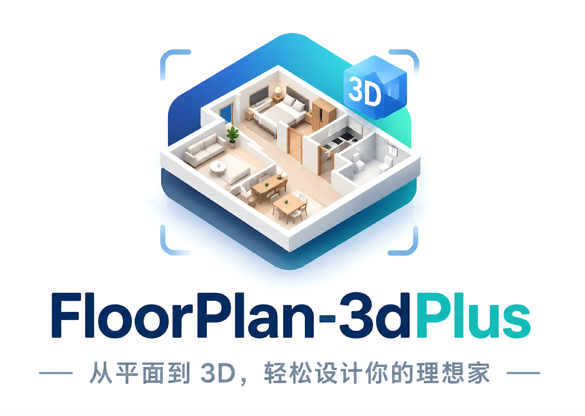
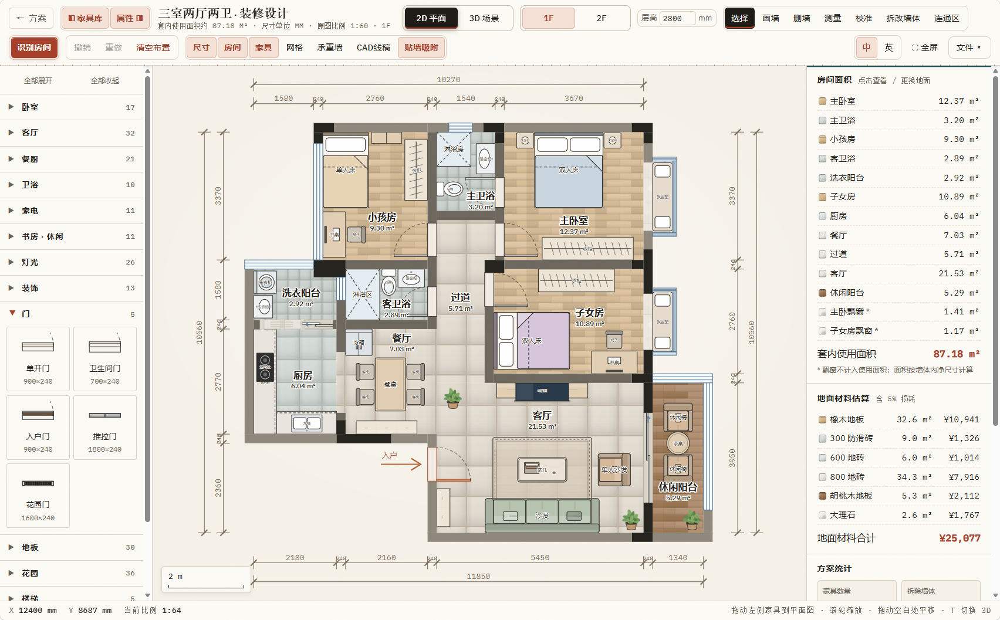
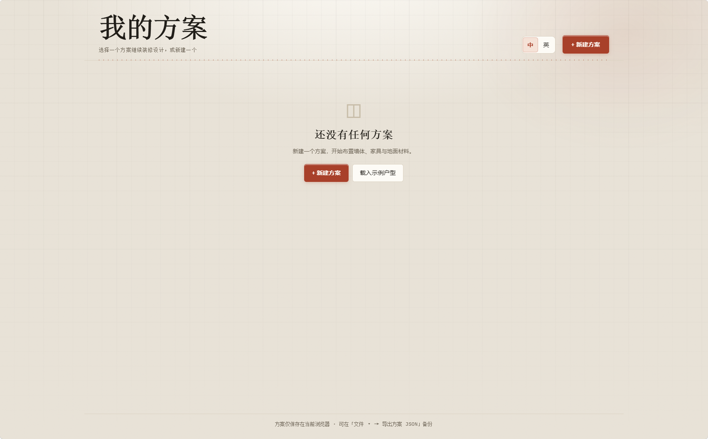
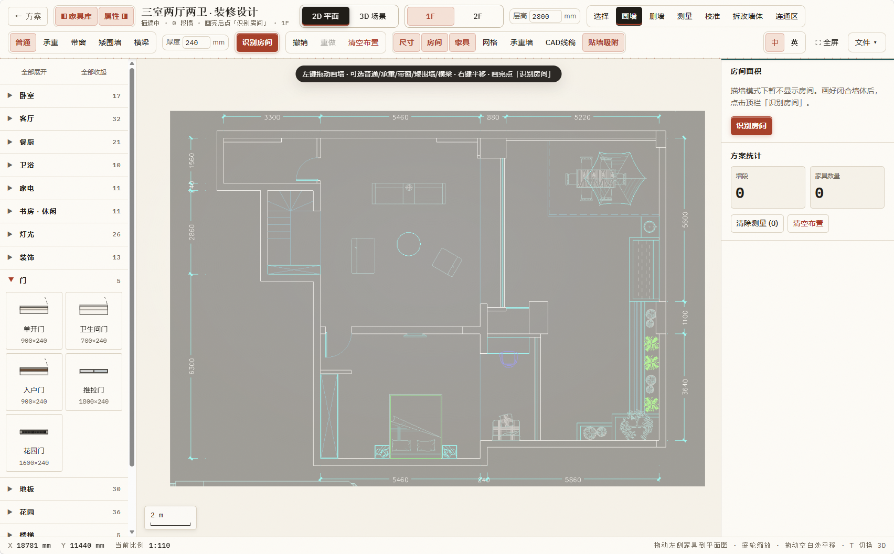
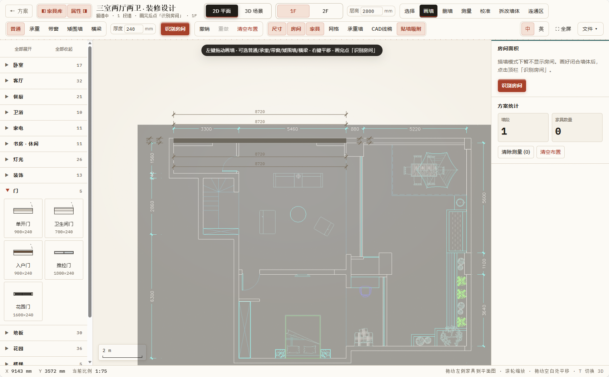
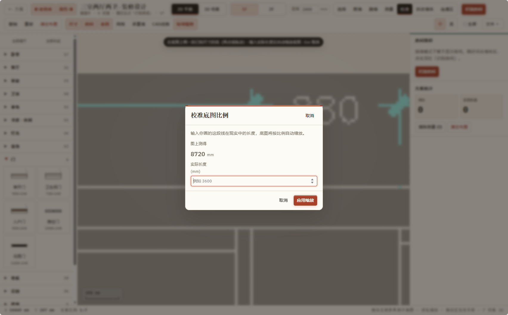
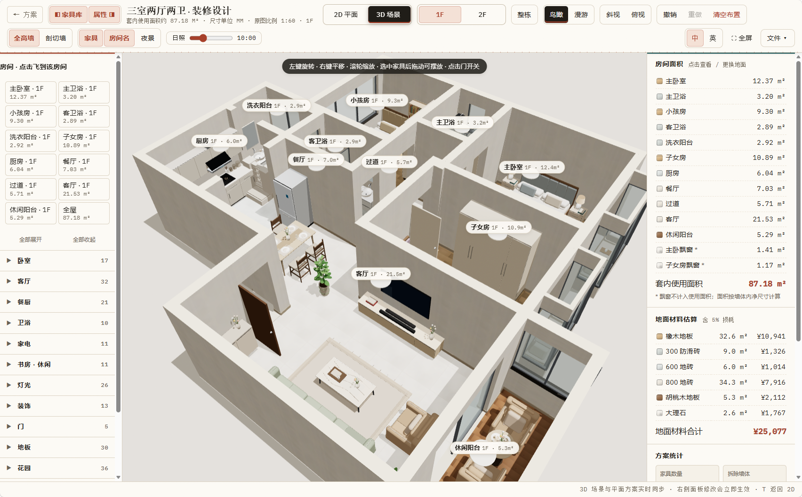

<p align="center">
  
</p>

<p align="center">Pure front-end floor-plan design · fast manual drawing · AI / file import · furniture & lighting controls</p>

<p align="center">
  <a href="https://raw.githack.com/lcbkmm/FloorPlan-3dPlus/main/index.html" target="_blank" rel="noopener noreferrer"><strong>Open app</strong></a>
  &nbsp;&bull;&nbsp;
  <a href="#quick-start"><strong>Quick start</strong></a>
  &nbsp;&bull;&nbsp;
  <a href="#whats-new-vs-floorplan-3d"><strong>What's new</strong></a>
  &nbsp;&bull;&nbsp;
  <a href="./README.md"><strong>简体中文</strong></a>
</p>

<p align="center">
  
  
  
  
  
</p>

<p align="center">
  <a href="https://github.com/lcbkmm"></a>
</p>

<p align="center">
  ⭐ <em>If this helps you, star the repo so more people can find it.</em>
</p>

## What it is

**FloorPlan-3dPlus** is a pure front-end interior design tool: draw walls, place furniture, change flooring and measure on a **2D plan**, then switch to a **Three.js 3D** bird's-eye view or first-person walkthrough. No framework, no build step — open `index.html` and go.

This project is inspired by open-source [**FloorPlan-3d**](https://github.com/wy51ai/floorplan-3d) ([`wy51ai/floorplan-3d`](https://github.com/wy51ai/floorplan-3d)). If you like the core 2D + 3D idea, please also star the original repository.

### What's new vs FloorPlan-3d

| Focus | Description |
| --- | --- |
| **Fast manual drawing** | Orthogonal walls, wall type / thickness, room detection, underlay calibration — build an editable plan quickly from blank or a scanned layout |
| **AI / file import** | CAD (DXF) import and floor-plan underlay tracing to reach an editable design faster than drawing every wall from scratch |
| **Furniture expansions** | Richer catalog and detailed 3D models (including lighting, garden, stairs, and more) |
| **Lighting controls** | Time-of-day sun slider, night mode, real point / spot lights from placed fixtures |

Also includes multi-floor (1F / 2F), link-area cut-outs, a plan gallery with local auto-save, and a Chinese / English UI.

<p align="center">
  
</p>
<p align="center"><em>2D plan: furniture library, dimensions, room areas and flooring cost estimate.</em></p>

## Quick start

Use online (no clone required):

→ [Open app](https://raw.githack.com/lcbkmm/FloorPlan-3dPlus/main/index.html)

> Note: do not deep-link `index.html` via jsDelivr — it is often served as `text/plain` and the browser shows source. The link above uses raw.githack with a proper `text/html` MIME type. After enabling GitHub Pages, you can also use [lcbkmm.github.io/FloorPlan-3dPlus](https://lcbkmm.github.io/FloorPlan-3dPlus/).

Run locally:

```bash
git clone https://github.com/lcbkmm/FloorPlan-3dPlus.git
cd FloorPlan-3dPlus
```

Open [`index.html`](./index.html) in a browser, or serve locally:

```bash
python -m http.server 8000
# visit http://localhost:8000
```

> Three.js loads from the jsDelivr CDN — a network connection is required the first time you enter 3D.

## Screenshots

### Plan gallery

<p align="center">
  
</p>
<p align="center"><em>Empty “My plans” · language toggle · new plan or load a sample.</em></p>

### Fast manual drawing

<table>
  <tr>
    <td width="50%" align="center">
      
      <br><em>Draw wall · type / thickness · detect rooms</em>
    </td>
    <td width="50%" align="center">
      
      <br><em>1F / 2F · link areas · doors & furniture</em>
    </td>
  </tr>
</table>

### Underlay calibration & import

<p align="center">
  
</p>
<p align="center"><em>Calibrate underlay by entering a known real-world length.</em></p>

### 3D scene & lighting

<p align="center">
  
</p>
<p align="center"><em>3D orbit: room labels, full / cut walls, sun slider, walkthrough entry.</em></p>

## Feature highlights

**Plans**
- Gallery cards with thumbnail, area, floors and height; create / rename / duplicate / delete
- Auto-save in the browser; export full multi-floor JSON from **File ▾**

**Drawing & import**
- Draw / erase / measure / calibrate / edit walls / link areas; bearing walls marked
- Upload a floor-plan image as underlay; import DXF into an editable 2D / 3D plan

**Furniture & lighting**
- 70+ items with snap, rotate and 2D ↔ 3D sync
- Sun time, night mode, fixture point / spot lighting
- Flooring materials with cost estimate (area + 5% waste)

**3D & multi-floor**
- Orbit / oblique / top; fly to rooms; walkthrough (WASD / joystick) with door open/close
- Single-floor by default; stack the building in walkthrough or **Whole building** preview; link areas cut stair voids

## Shortcuts

| Key | Action |
| --- | --- |
| `T` | Toggle 2D / 3D |
| `V` / `W` / `E` / `M` / `X` / `L` | Select / Draw wall / Erase / Measure / Edit walls / Link area |
| `R` / `Shift+R` | Rotate selected furniture 90° |
| `Delete` / `Backspace` | Delete selection |
| `Ctrl/⌘ + D` | Duplicate |
| `Ctrl/⌘ + Z`，`Ctrl/⌘ + Shift + Z` | Undo / redo |
| `F` | Fit view |
| `+` / `-` | Zoom |
| `[` / `]` | Toggle library / panel |
| `Shift + F` | Fullscreen |
| `Esc` | Cancel |
| Walk: `WASD` / arrows, `Shift`, `E` | Move, run, toggle door |

## Tech stack

- Vanilla HTML / CSS / JavaScript — no framework, no build
- Entry [`index.html`](index.html) · [`css/app.css`](css/app.css) · [`js/`](js/)
- 2D: SVG; DXF: [`js/dxf-import.js`](js/dxf-import.js)
- 3D: [Three.js](https://threejs.org/) r160; entry [`js/view3d.js`](js/view3d.js) under [`js/view3d/`](js/view3d/)
- Classic ↔ module bridge: [`js/bridge-3d.js`](js/bridge-3d.js)
- Multi-floor: [`js/floors.js`](js/floors.js); data in `localStorage`

## Customize the plan

| File | Contents |
| --- | --- |
| [`js/plan-data.js`](js/plan-data.js) | `ROOMS`, `WALLS` / `WINS` / `DOORS`, … |
| [`js/catalog.js`](js/catalog.js) | `MATS`, `LIB` |
| [`js/view3d/furniture.js`](js/view3d/furniture.js) | `buildFurniture()` models |

Edit these to use your own floor plan.

## Acknowledgements

Inspired by [wy51ai/floorplan-3d](https://github.com/wy51ai/floorplan-3d) (MIT). FloorPlan-3dPlus extends that direction with faster manual drawing, import flows, furniture expansions and lighting controls.

## License

[MIT](LICENSE)

---

<p align="center">
  <a href="https://github.com/lcbkmm">GitHub @lcbkmm</a>
  ·
  <a href="./README.md">简体中文</a>
</p>
