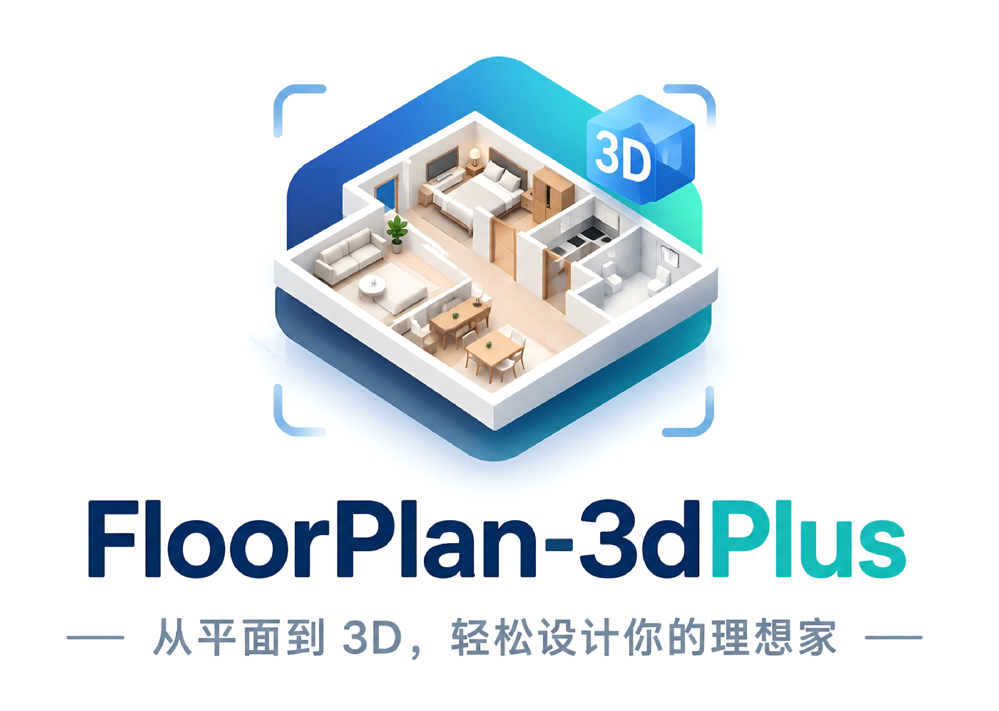
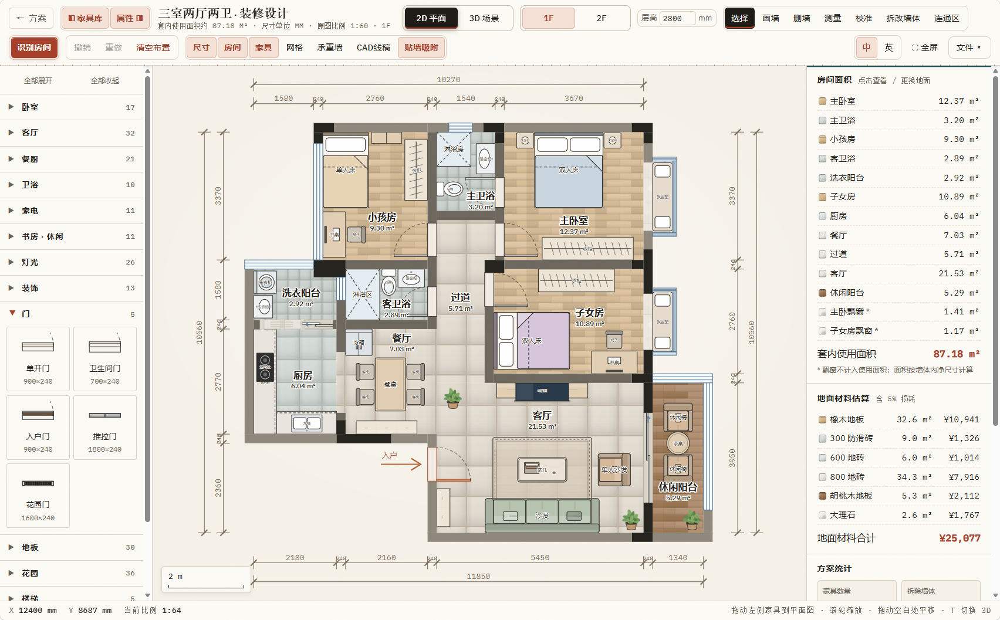
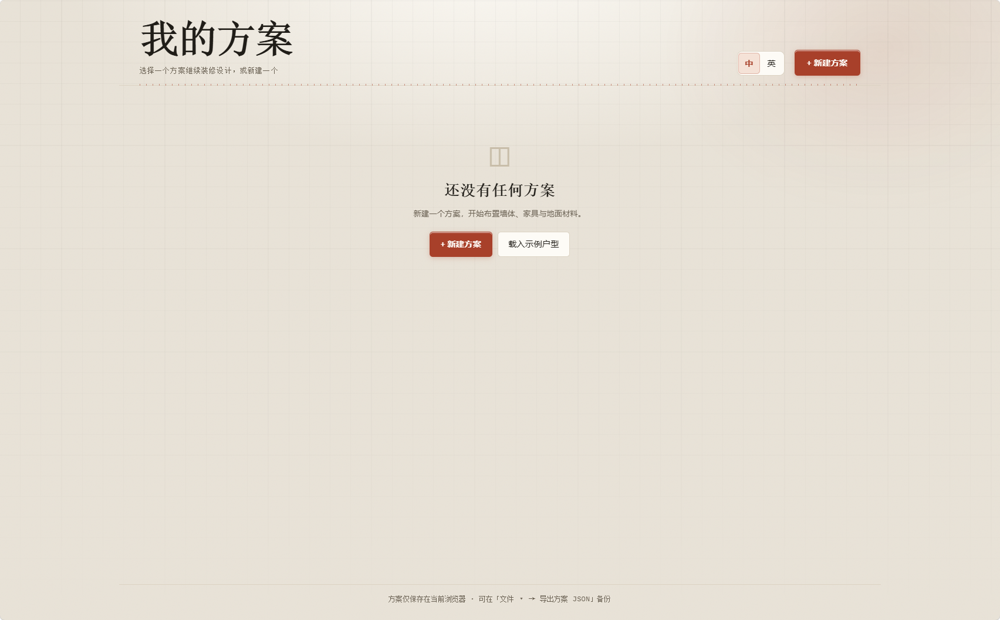
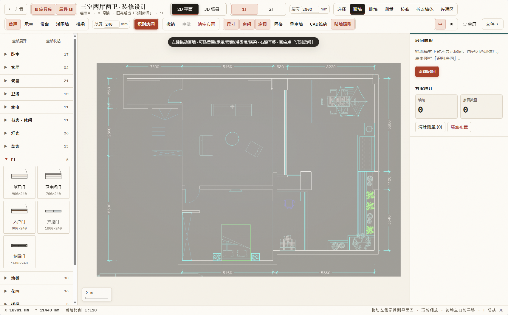
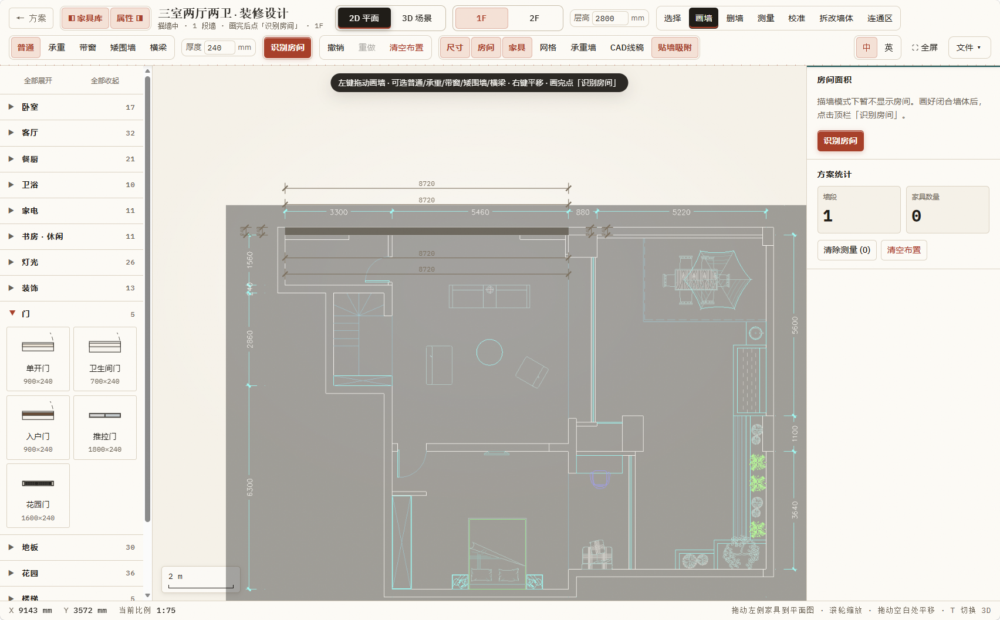
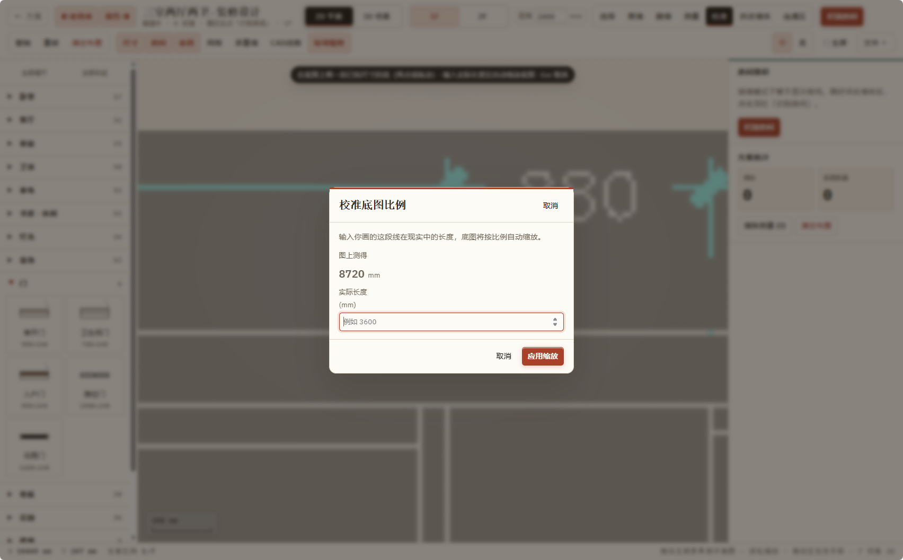
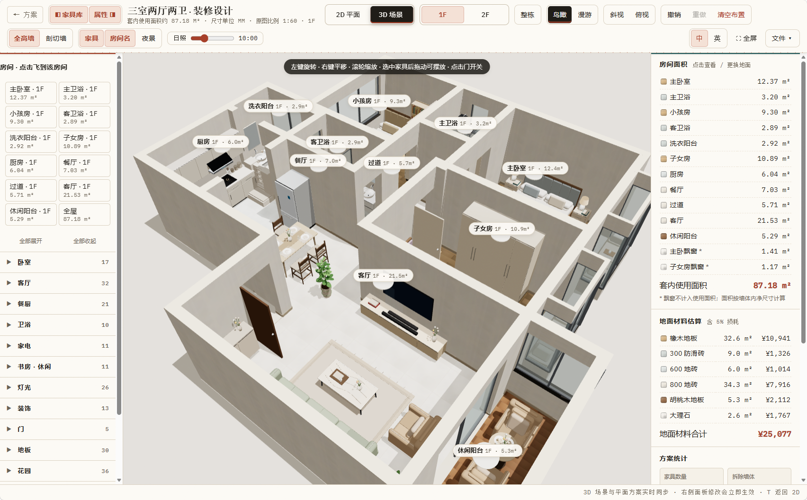

<p align="center">
  
</p>

<p align="center">纯前端户型装修设计 · 手动快画 · AI 导入 · 家具与灯光调节 · 打开即用</p>

<p align="center">
  <a href="https://cdn.jsdelivr.net/gh/lcbkmm/FloorPlan-3dPlus@main/index.html" target="_blank" rel="noopener noreferrer"><strong>打开应用</strong></a>
  &nbsp;&bull;&nbsp;
  <a href="#快速开始"><strong>快速开始</strong></a>
  &nbsp;&bull;&nbsp;
  <a href="#相对-floorplan-3d-的增强"><strong>增强点</strong></a>
  &nbsp;&bull;&nbsp;
  <a href="./README.en.md"><strong>English</strong></a>
</p>

<p align="center">
  
  
  
  
  
</p>

<p align="center">
  <a href="https://github.com/lcbkmm"></a>
</p>

<p align="center">
  ⭐ <em>觉得好用的话，给仓库点个 Star，让更多人看见。</em>
</p>

## 这是什么

**FloorPlan-3dPlus** 是一款纯前端户型装修设计工具：在 **2D 平面图**上画墙、摆家具、换地面、量尺寸，一键切到 **Three.js 3D** 鸟瞰或第一人称漫游。无框架、无构建步骤，打开 `index.html` 即可。

本项目从开源项目 [**FloorPlan-3d**](https://github.com/wy51ai/floorplan-3d)（[`wy51ai/floorplan-3d`](https://github.com/wy51ai/floorplan-3d)）获取灵感，在其「2D 布置 + 3D 漫游」思路之上继续扩展。若你觉得基础体验很好用，也请给原项目一个 Star。

### 相对 FloorPlan-3d 的增强

| 特色 | 说明 |
| --- | --- |
| **手动快速画图** | 正交画墙、墙体类型 / 厚度、识别房间、底图校准等，从空白或户型图快速搭出可编辑平面 |
| **AI / 文件导入** | 支持导入 CAD（DXF）与户型图底图描墙，更快进入可编辑方案（相对纯手工从零摆墙） |
| **家具扩展** | 更丰富的家具库与精细 3D 模型（含灯光、花园、楼梯等品类） |
| **灯光调节** | 日照时间滑块、夜景模式、灯具真实点光 / 射灯照明，可按摆放调节室内氛围 |

此外还支持多楼层（1F / 2F）、连通区挖空、方案列表与本地自动保存，界面中 / 英切换。

<p align="center">
  
</p>
<p align="center"><em>2D 平面：家具库、尺寸标注、房间面积与地面材料造价。</em></p>

## 快速开始

在线直接使用（无需克隆）：

→ [打开应用（index.html）](https://cdn.jsdelivr.net/gh/lcbkmm/FloorPlan-3dPlus@main/index.html)

本地运行：

```bash
git clone https://github.com/lcbkmm/FloorPlan-3dPlus.git
cd FloorPlan-3dPlus
```

直接用浏览器打开 [`index.html`](./index.html)，或起一个本地静态服务：

```bash
python -m http.server 8000
# 访问 http://localhost:8000
```

> Three.js 通过 jsDelivr CDN 加载，首次进入 3D 需要联网。

## 界面预览

### 方案列表

启动后先进入方案页：新建、载入示例，或继续编辑已有方案。

<p align="center">
  
</p>
<p align="center"><em>「我的方案」空态 · 中 / 英切换 · 新建或载入示例户型。</em></p>

### 手动快速画图

从空白或底图开始正交画墙，点「识别房间」生成可编辑户型；可调墙体类型、厚度与连通区。

<table>
  <tr>
    <td width="50%" align="center">
      
      <br><em>画墙工具 · 墙体类型 / 厚度 · 识别房间</em>
    </td>
    <td width="50%" align="center">
      
      <br><em>1F / 2F · 连通区 · 家具库与门窗</em>
    </td>
  </tr>
</table>

### 底图校准与导入

上传户型图后，画已知长度线段并输入实际尺寸，底图按比例缩放；亦可导入 DXF 生成可编辑户型。

<p align="center">
  
</p>
<p align="center"><em>校准底图：输入实际长度，自动套用比例。</em></p>

### 3D 场景与灯光

鸟瞰 / 斜视 / 俯视，全高墙或剖切墙；日照与夜景下灯具照明可调；漫游从入户门内侧起步。

<p align="center">
  
</p>
<p align="center"><em>3D 鸟瞰：房间标签、全高 / 剖切、日照滑块、漫游入口。</em></p>

## 功能亮点

**方案管理**
- 启动页卡片列表：缩略图、面积、层数、层高；新建 / 重命名 / 复制 / 删除
- 编辑自动保存到当前浏览器；「文件 ▾ → 导出方案 JSON」做完整备份

**手动快速画图 & 导入**
- 正交画墙 / 删墙 / 测量 / 校准 / 拆改墙体 / 连通区；承重墙单独标示
- 上传户型图底图描墙；导入 CAD（DXF）生成可编辑 2D / 3D 方案

**家具与灯光**
- 70+ 家具家电可拖入、旋转、贴墙吸附；2D / 3D 实时同步
- 日照时间、夜景模式；多样灯具及真实点光 / 射灯照明
- 地面材料与按面积（+5% 损耗）的造价估算

**3D 与多楼层**
- 鸟瞰、斜视、俯视；房间列表一键飞入；漫游（WASD / 摇杆）点门开关
- 2D 与鸟瞰默认单层；漫游或「整栋」预览堆叠整栋；连通区挖空楼梯口 / 挑空

## 快捷键

| 按键 | 作用 |
| --- | --- |
| `T` | 切换 2D / 3D |
| `V` / `W` / `E` / `M` / `X` / `L` | 选择 / 画墙 / 删墙 / 测量 / 拆改墙体 / 连通区 |
| `R` / `Shift+R` | 选中家具顺 / 逆时针旋转 90° |
| `Delete` / `Backspace` | 删除选中家具 |
| `Ctrl/⌘ + D` | 复制选中家具 |
| `Ctrl/⌘ + Z`，`Ctrl/⌘ + Shift + Z` | 撤销，重做 |
| `F` | 适应窗口 |
| `+` / `-` | 放大 / 缩小 |
| `[` / `]` | 展开 / 收起左侧家具库、右侧面板 |
| `Shift + F` | 全屏 |
| `Esc` | 取消当前操作 |
| 漫游：`WASD` / 方向键，`Shift`，`E` | 移动，快走，开关门 |

## 技术栈

- 原生 HTML / CSS / JavaScript，无框架、无构建
- 入口 [`index.html`](index.html) · [`css/app.css`](css/app.css) · [`js/`](js/)
- 2D：SVG；DXF：[`js/dxf-import.js`](js/dxf-import.js)
- 3D：[Three.js](https://threejs.org/) r160；入口 [`js/view3d.js`](js/view3d.js)，实现在 [`js/view3d/`](js/view3d/)
- 经典脚本与 ES 模块桥接：[`js/bridge-3d.js`](js/bridge-3d.js)
- 多楼层：[`js/floors.js`](js/floors.js)；数据存 `localStorage`

## 自定义户型

| 文件 | 内容 |
| --- | --- |
| [`js/plan-data.js`](js/plan-data.js) | `ROOMS`、`WALLS` / `WINS` / `DOORS` 等几何 |
| [`js/catalog.js`](js/catalog.js) | `MATS` 地面材料、`LIB` 家具库 |
| [`js/view3d/furniture.js`](js/view3d/furniture.js) | `buildFurniture()` 等 3D 模型 |

改这些数据即可换成自己的户型。

## 致谢

灵感来自 [wy51ai/floorplan-3d](https://github.com/wy51ai/floorplan-3d)（MIT）。FloorPlan-3dPlus 在其交互与 3D 漫游方向上继续扩展手动快画、导入流程、家具与灯光能力。

## 许可协议

[MIT](LICENSE)

---

<p align="center">
  <a href="https://github.com/lcbkmm">GitHub @lcbkmm</a>
  ·
  <a href="./README.en.md">English README</a>
</p>
